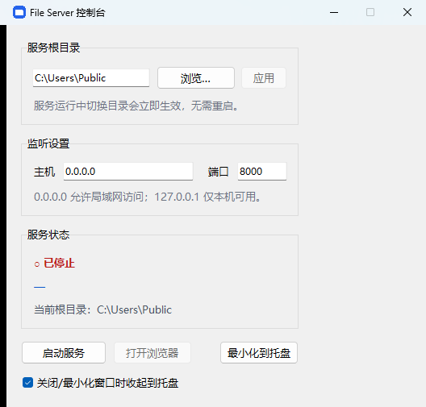

# File Server

**English** | [简体中文](README.zh-CN.md)

[](LICENSE)
[](https://www.python.org/)
[](#requirements)

A tiny, read-only LAN file server for Windows. Share a folder, then browse,
preview, and download files from any browser on your network. The desktop
control panel can start and stop the server, switch the shared folder at
runtime, and minimize to the system tray.

## Features

- Browse folders, preview files, and download them from a browser
- Inline previews for images, audio, video, PDF, and small text files
- HTTP Range support for seeking and streaming large media files
- Read-only: no upload, delete, or rename endpoints
- Desktop control panel with start/stop, host/port, and live root switching
- System tray: close or minimize the window and keep serving in the background
- Settings persisted in `%APPDATA%\DFileServer\config.json`
- No dependencies for the CLI server (Python standard library only); the GUI
  needs Pillow and pystray



## Requirements

- Python 3.11 or newer
- Windows 10/11 for the desktop control panel and tray icon (the CLI server is
  platform-independent)

## Quick start

```powershell
git clone https://github.com/ColonelDarcy2018/file-server.git
cd file-server
uv venv
uv pip install -r requirements.txt
.\.venv\Scripts\pythonw.exe .\gui.py
```

Use `python.exe` instead of `pythonw.exe` if you want a console with logs.

If you only need the command-line server:

```powershell
python .\server.py --root "E:\"
```

The default share root is your user profile. The GUI remembers the last root,
host, and port in `%APPDATA%\DFileServer\config.json`.

### Firewall

To reach the server from other devices, allow inbound TCP traffic on the chosen
port (8000 by default) in Windows Firewall.

## Desktop control panel

- **Start / Stop** toggles the HTTP server.
- **Browse / Apply** picks a folder. While the server is running, applying a
  new folder takes effect immediately without a restart.
- **Open in browser** opens the LAN URL.
- **Minimize to tray** hides the window; with the tray option checked, closing
  or minimizing the window also keeps the server running in the background.
  Double-click the tray icon to restore the window. The tray menu can also
  start/stop the server and exit.

## CLI options

```text
usage: server.py [-h] [--root ROOT] [--host HOST] [--port PORT]
                 [--max-preview-bytes MAX_PREVIEW_BYTES]
```

| Option | Default | Description |
| --- | --- | --- |
| `--root` | user home | Folder to serve |
| `--host` | `0.0.0.0` | Bind address; use `127.0.0.1` for local-only access |
| `--port` | `8000` | TCP port |
| `--max-preview-bytes` | `1000000` | Max size for inline text previews |

## Build Windows executables

```powershell
.\build.ps1
```

Outputs:

- `dist\file-server.exe` — console/CLI server
- `dist\file-server-gui.exe` — windowed control panel with tray support

## Project layout

```text
server.py        HTTP server, browsing, preview, and download
gui.py           Tkinter control panel and system tray
build.ps1        PyInstaller build script
```

## License

[MIT](LICENSE)
