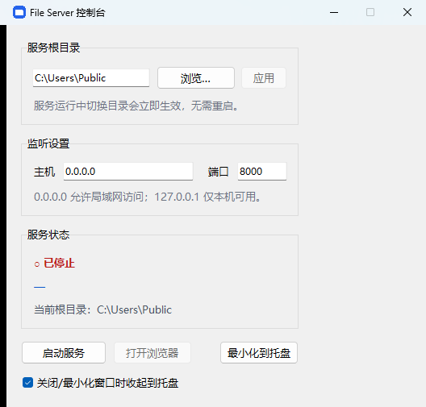

# D File Server

[English](README.md) | **简体中文**

[](LICENSE)
[](https://www.python.org/)
[](#环境要求)

一个极简的 Windows 局域网只读文件服务器。共享一个目录后，局域网内任意设备
都可以用浏览器浏览、预览和下载文件。图形控制面板支持启停服务、运行时切换
共享目录，以及最小化到系统托盘。

## 功能

- 浏览器内浏览目录、预览文件、下载文件
- 图片、音频、视频、PDF 和小型文本文件的行内预览
- 支持 HTTP Range，视频拖动进度和大文件流式传输可用
- 只读：没有上传、删除、重命名接口
- 图形控制面板：启停服务、修改主机/端口、运行时切换根目录
- 系统托盘：关闭或最小化窗口后继续在后台提供服务
- 配置保存在 `%APPDATA%\DFileServer\config.json`
- CLI 服务器零第三方依赖（仅标准库）；GUI 需要 Pillow 和 pystray



## 环境要求

- Python 3.11 或更高版本
- 图形面板和托盘需要 Windows 10/11（CLI 服务器不依赖特定平台）

## 快速开始

```powershell
git clone https://github.com/ColonelDarcy2018/d-file-server.git
cd d-file-server
uv venv
uv pip install -r requirements.txt
.\.venv\Scripts\pythonw.exe .\gui.py
```

如果你需要查看控制台日志，把 `pythonw.exe` 换成 `python.exe`。

只使用命令行服务器：

```powershell
python .\server.py --root "E:\"
```

默认共享目录是当前用户的主目录。GUI 会记住上次使用的根目录、主机和端口，
保存在 `%APPDATA%\DFileServer\config.json`。

### 防火墙

如果要从其他设备访问，需要在 Windows 防火墙中放行所选端口（默认 8000）的
入站 TCP 流量。

## 图形控制面板

- **启动 / 停止**：切换 HTTP 服务状态。
- **浏览 / 应用**：选择目录。服务运行中应用新目录会立即生效，无需重启。
- **打开浏览器**：打开局域网访问地址。
- **最小化到托盘**：隐藏窗口。勾选托盘选项后，关闭或最小化窗口都会让服务
  继续在后台运行。双击托盘图标可恢复窗口；托盘菜单也可以启停服务和退出。

## 命令行参数

```text
usage: server.py [-h] [--root ROOT] [--host HOST] [--port PORT]
                 [--max-preview-bytes MAX_PREVIEW_BYTES]
```

| 参数 | 默认值 | 说明 |
| --- | --- | --- |
| `--root` | 用户主目录 | 共享的根目录 |
| `--host` | `0.0.0.0` | 监听地址；`127.0.0.1` 仅本机可访问 |
| `--port` | `8000` | 监听端口 |
| `--max-preview-bytes` | `1000000` | 文本预览的最大字节数 |

## 构建 Windows 可执行文件

```powershell
.\build.ps1
```

输出：

- `dist\d-file-server.exe` — 控制台/CLI 服务器
- `dist\d-file-server-gui.exe` — 带托盘功能的图形控制面板

## 项目结构

```text
server.py        HTTP 服务器、目录浏览、预览、下载
gui.py           Tkinter 控制面板与系统托盘
build.ps1        PyInstaller 打包脚本
```

## 许可证

[MIT](LICENSE)
